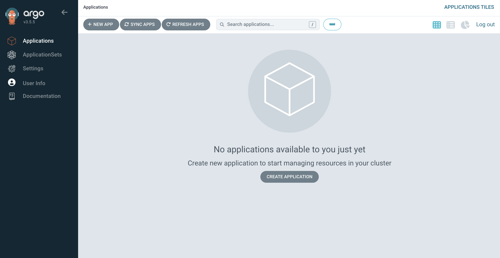
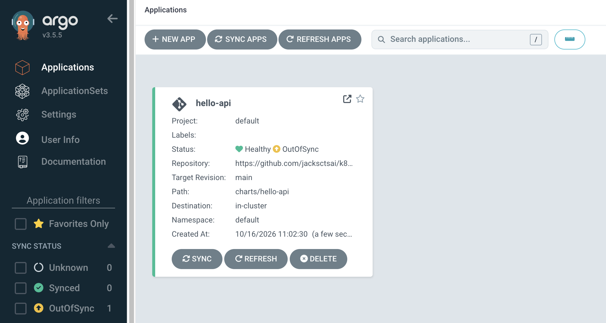
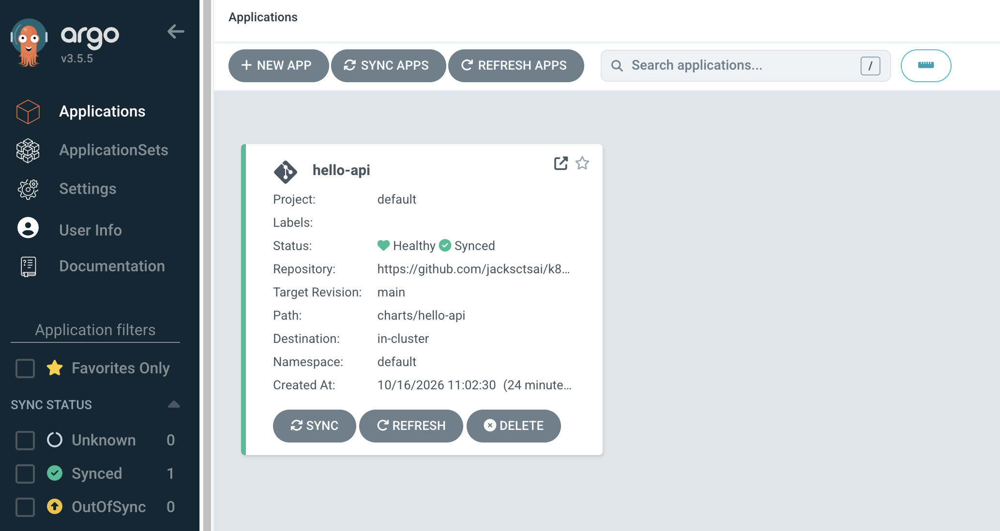
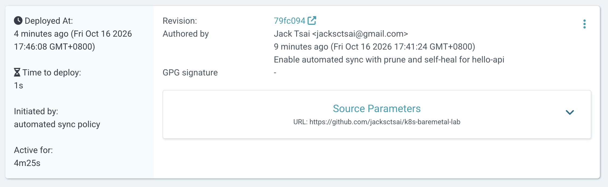

# Day 5


## Install Argo CD

First, we create a namespace `argocd` for Argo CD resources.

```
$ kubectl create namespace argocd
$ kubectl apply -n argocd --server-side --force-conflicts -f https://raw.githubusercontent.com/argoproj/argo-cd/stable/manifests/install.yaml
```

Install Argo CD CLI tools. Using homebrew to install it will end up in CMake error, we will use curl to download binary instead.

```
$ VERSION=$(curl --silent "https://api.github.com/repos/argoproj/argo-cd/releases/latest" | grep '"tag_name"' | sed -E 's/.*"([^"]+)".*/\1/')
$ curl -sSL -o argocd https://github.com/argoproj/argo-cd/releases/download/$VERSION/argocd-darwin-arm64
$ sudo install -m 555 argocd /usr/local/bin/argocd
$ rm argocd
```

By default, Argo CD isn’t exposed outside the cluster. Setup port forwarding with `kubectl port-forward` so we can connect to the API server without exposing the service.

```
$ kubectl port-forward svc/argocd-server -n argocd 8080:443
```

Now we can access the API server using https://localhost:8080

Before we can login, we still need the auto-generated initial password for the `admin` account. We can retrive that using the `argocd` CLI tool.

```
$ argocd admin initial-password -n argocd
```

This is the first look of the Argo CD API Server.




### Pointing Argo CD at the chart with an Argo CD Application

The application manifest is created at [argocd/hello-api.yaml](../argocd/hello-api.yaml). We apply it with `kubectl apply` and leave it auto-sync off for now.

```
$ kubectl apply -n argocd -f argocd/hello-api.yaml
application.argoproj.io/hello-api created
```

Go to the Argo CD API server UI, we can see the application is created but out of sync.



To work on the out-of-sync problem, we can look at the diff on the UI. But I prefer to use CLI tool to get searchable text with `argocd app diff`.

```
$ argocd app diff hello-api
{"level":"fatal","msg":"Argo CD server address unspecified","time":"2026-10-16T11:06:47+08:00"}
```

We haven't logged in to the API server yet on the CLI tool. We can do so with `argocd login`. The TLS warning is telling us the certificate is not verifiable because it is a self-signed certificate by default, which is fine in our lab case.

```
$ argocd login 127.0.0.1:8080
WARNING: server certificate had error: error creating connection: tls: failed to verify certificate: x509: certificate signed by unknown authority. Proceed insecurely (y/n)? y
Username: admin
Password:
'admin:login' logged in successfully
Context '127.0.0.1:8080' updated

$ argocd app diff hello-api

===== apps/Deployment default/hello-api ======
172a173,175
>         - containerPort: 0
>           name: http
>           protocol: TCP
```

`service.targetPort` was missing from the committed `values.yaml`, so Argo CD, which renders the chart from git, got an empty value and rendered `containerPort: 0`. The live Deployment still had 8080 from an earlier install, so the gap went unnoticed until Argo CD compared git against the cluster.

We added it back and confirmed with `helm template` and then pushed the changes.

```
$ helm template charts/hello-api | grep -B2 -A2 containerPort
          ports:
            - name: http
              containerPort: 8080
              protocol: TCP
          livenessProbe:

$ git add charts/hello-api/values.yaml
$ git commit -m 'Add missing service.targetPort to hello-api values'
$ git push
```

Now we go to the API server and refresh, we can see the application status became `Synced` without a manual sync after the push.




### Handing Ownership Over

Next is handing ownership over to Argo CD. Helm still keeps a release record for `hello-api`, so a stray `helm upgrade` would fight Argo CD.

```
$ helm list -n default
NAME      NAMESPACE REVISION  UPDATED                               STATUS    CHART           APP VERSION
hello-api default   3         2026-10-15 12:15:16.287484 +0800 CST  deployed  hello-api-0.1.0 v2.0.1

$ kubectl -n default get secret -l owner=helm
NAME                              TYPE                 DATA   AGE
sh.helm.release.v1.hello-api.v1   helm.sh/release.v1   1      29h
sh.helm.release.v1.hello-api.v2   helm.sh/release.v1   1      29h
sh.helm.release.v1.hello-api.v3   helm.sh/release.v1   1      29h
```

As expected there are three revisions, one Secret each. We will delete those Secrets to removes Helm's memory of the release. The resources keep their Helm labels and meta.helm.sh annotations. That's fine, because Argo CD renders the same labels from the chart and ignores those annotations.

```
$ kubectl -n default delete secret -l owner=helm,name=hello-api
secret "sh.helm.release.v1.hello-api.v1" deleted from default namespace
secret "sh.helm.release.v1.hello-api.v2" deleted from default namespace
secret "sh.helm.release.v1.hello-api.v3" deleted from default namespace

$ helm list -n default                 # should be empty
NAME  NAMESPACE REVISION  UPDATED STATUS  CHART APP VERSION

$ kubectl -n default get deploy,svc,cm -l app.kubernetes.io/instance=hello-api
NAME                        READY   UP-TO-DATE   AVAILABLE   AGE
deployment.apps/hello-api   3/3     3            3           29h

NAME                TYPE       CLUSTER-IP     EXTERNAL-IP   PORT(S)          AGE
service/hello-api   NodePort   10.109.65.30   <none>        8080:30080/TCP   29h

NAME                         DATA   AGE
configmap/hello-api-config   1      29h

$ argocd app get hello-api             # should still be Synced/Healthy
Name:               argocd/hello-api
Project:            default
Server:             https://kubernetes.default.svc
Namespace:          default
URL:                https://127.0.0.1:8080/applications/hello-api
Source:
- Repo:             https://github.com/jacksctsai/k8s-baremetal-lab
  Target:           main
  Path:             charts/hello-api
SyncWindow:         Sync Allowed
Sync Policy:        Manual
Sync Status:        Synced to main (3c2e70a)
Health Status:      Healthy

GROUP  KIND        NAMESPACE  NAME              STATUS  HEALTH   HOOK  MESSAGE
       ConfigMap   default    hello-api-config  Synced
       Service     default    hello-api         Synced  Healthy
apps   Deployment  default    hello-api         Synced  Healthy
```

Then we turn on auto-sync and self-heal in git by add `syncPolicy` under `spec:` in `argocd/hello-api.yaml`.

```
  syncPolicy:
    automated:
      prune: true
      selfHeal: true
```

We then need to apply the edits by `kubectl apply -n argocd -f argocd/hello-api.yaml` since the Application object itself isn't managed by Argo CD.


### Self-heal Test

Now Argo CD should manage the resources. Let's cause some drift on purpose and see how it gets healed.

```
$ kubectl -n default scale deploy hello-api --replicas=1
deployment.apps/hello-api scaled

$ kubectl -n default get deploy hello-api -w
NAME        READY   UP-TO-DATE   AVAILABLE   AGE
hello-api   1/1     1            1           29h
hello-api   1/3     1            1           29h
hello-api   1/3     1            1           29h
hello-api   1/3     1            1           29h
hello-api   1/3     3            1           29h
hello-api   2/3     3            2           29h
hello-api   3/3     3            3           29h
```

We can actually see a history record from Argo CD CLI.

```
$ argocd app history hello-api
SOURCE  https://github.com/jacksctsai/k8s-baremetal-lab
ID      DATE                           REVISION
0       2026-10-16 17:46:08 +0800 CST  main (79fc094)
```

And for more detail we can get it from the Argo CD API server UI.




### Scaling-up Test

Let's change `replicaCount` to 4 in [values.yaml](../charts/hello-api/values.yaml) in git and see how it roll out without manual sync.

